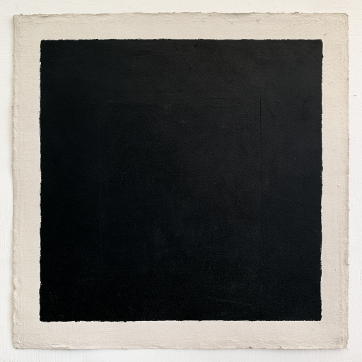

[Calistadalane Records](https://github.com/CalistadalaneRecords) ❰ [David, Zira, and Mark](../README.md) ❰ Black Square

<br/>

<div align="center">

  <h3>David, Zira, and Mark - Black Square</h3>

  

  | Track  | Title |
  |:------:|:------|
  | 01     | [Kind of Talking/Never Been](./KindOfTalking-NeverBeen.mp3) |
  | 02     | [Tagisimo, X](./TagisimoX.mp3) |
  | 03     | [Zoe (No.1)](./Zoe-No1.mp3) |

</div>

<br/>

Release: 2021

## Lyrics

### Kind Of Talking/Never Been

```text

Not really talking, but words come out.

You are saying things, but they don’t matter.

Weighted sigh at the end of the day kind of talking.

Drink domestic beers on your unfinished porch and wait for the city noise to ruin the sunset kind of talking.

We go for a silent walk somewhere and just point at rocks or something kind of talking.

“How are things”, but you don’t really want to know - you just want to know I am breathing kind of talking.

You invite me to something, but fail to give me any useful details when I shrug out a yes that I don’t mean because you didn’t even really want me to go anyway kind of talking.

That is the only kind of talking I’ve got in me.

Dying seems messy and hard.

There are people, you see.

They have feelings about you, and this, and it, and wouldn’t it have been easier if you had never been?

I stare off when he touches me.

I close my eyes and pretend I am not being - that I have never been.

My ears always refuse to quiet, so there is only loud.

In that loudness, he loves another, and this is good.

In that loudness, a form takes my place in all things, and this is good.

I am replaceable. There is a comfort in that.

I have never seen the ocean. I want to see it once, but I am scared.

I want to see the ocean, and I want him to love someone else, and I want to have never ever been.
```

### Tagisimo, X

Hello  

(Hello)  

I'm back  

(I'm back)  

I'll go back there again soon to further adventure, but now, the sea was blue  

Got woken by the circle of the dawn sun on the white of the closet door twice  
once it was pink  
the next time gold  

A few times I got up at seven  
hopped into swim stuff  
down the trail to beach and swam, all to myself  
no one but the little schools of transparent fish to look at with my snorkel mask  
and the tube let me stay face down and not miss anything and the water from the underside.  

And the way the sand shifts as you get closer to where the waves break the pattern  

The solidity and texture of water  

The volume  

The quiet of getting out on the beach after swimming along it and back in the morning breeze  
the sun on your shoulders  
your feet really planted  
you really stand on the earth  
quiet in your body and really with the moment that you are in  
just living  
appreciating and feeling a quiet part of it  

And walking up the path  
seeing the butterflies about their business  
going here and there  

Walking up with a lot more respect  
quietly stooping to pick up trash on the trail that so does not belong there its almost the punchline to some bad joke  

I came back to some part of myself who had run away cause my emotional life was a little too desperate there for a moment  

But I'm more strong now  

I lived it and I live  

I'm happy and lucky and appreciative and…  

Anyway.  

Had a quick, funny last minute adventure with a saxophonist  
who had an older brother who fell in love with my friend and roommate Julie  
and so that's why we return there soon

The saxophonist kept complaining that I had too much manic energy  
which was irritating  
even though I knew he was right  

It takes a while to settle down and be normal after a lot of stress  

And so now of course I am determined to be the coolest thing in the sea the next time I see him  

Should be fun, another role to dance around in  
but mostly I'll just be happy to swim again  

And maybe sit on the beach next to a fire  
and write messages in the sand that no one can see and the tide will erase later  

How romantic  

I took the train to Genova and then a boat to the island of Sardinia  

The train lasted all night  
then we had all day to trudge around Genova  
and then the boat at night  
and then the morning  
yes  
genuine seagulls coming to greet the boat when we landed  

And the island coming up  
and the water deep  
impossible blue  
and you just get lost in the texture of the wake  
and  
stupid me  
no creme on the legs and so then I have like a 3rd degree red frontal sock burn  

I look so the German tourist  

And they did not go away for the whole trip  

It was my personal goal  
but nope  
there they are  
even now

I'm kind of unevenly brown everywhere  
but  
so what?  

And then the boat back  
but during the whole damn day surrounded by lots of completely spoiled rich Italian children whose parents just try and rationalize them out of bad moods until you are not sure who is whining more, the parents or the kids (who just continue to move determinedly in the direction they want)  

But sailing into Genova was fun too  

So now I've done the Columbus thing  
sans Indians  
felt the miles of the true distance I'm travelling  
and I found out when I got home that the plane was the same price and it took 2 hours  

So  

Next time  

Tag  
is  
imo  

X

### Zoe (No. 1)

Zoe.
Thank you for responding to the message. I’m sorry if I attacked you on an issue. I threw your letters away a long time ago and you have something against me. You said you hated the state of Maryland on a postcard, and I didn’t know what you meant by that. You said you hated things a long time ago and never switched that to love. Yes, I am ready to move on. I’m having problems with my family and wanted to know if you were involved. I loved you and missed you. I’ll leave you alone if need be. I did want to marry you. I’m sorry I’m responding to your do not contact me again. If there were any problems with the past relationship you should tell me now because it might disrupt the future. I’m sorry if I disrupted you. I’m trying to move in another year. You have been in my thoughts lately. I remember you most in middle school and somewhat in high school. I got your last post card when you first moved and haven’t heard since. I’ll move on if need be. You were in my first thoughts to get married. You can take it or leave it. I wanted to apologize to you about the past. I didn’t invite you to my parents’ house. I didn’t know why I didn’t ask you. I should have called you more. I tried calling your cellphone more than five times and you never picked up. I thought you were beautiful and sexy. I apologize if you have a boyfriend. I’ve been single for a few years and missed you. I’m sorry I didn’t put more moves on you. I didn’t take the relationship seriously. I wanted to know if the previous relationship could be clean slate. I’m sorry if I hurt your feelings. I’ve always thought you were more intelligent with me. I wish you would have told me more of what you wanted. I didn’t catch all of your phrases. Sometimes I cry at night thinking of you. My stomach made me sick. I wasn’t professional with you. I’d like to get help one day if it would benefit you. I’d like to understand you. You made me feel good. I’d like to make you feel good. I’m sorry if I embarrassed you. I hope your schooling was good. I didn’t get the grades I wanted. I would take you more seriously. I’d like to give you what you wanted. I’m sorry about not keeping in touch with you. I should have invited you out when I had the chance. I’ve prayed for you before. I felt I got kicked out of that middle school and had to move someplace different. There were a lot of new things on my mind and should have adjusted with you more quickly. I made too many friends and should have kept things more simple. I didn’t study enough. I should have held on to your postal letters. I understand you wanting to move on. You popped out of nowhere on my mind. I know you’ve made new friends. Its difficult for me not to think of you. If I knew what I was doing I would have taken you out on a date. I thought when you first moved you wanted distance from me. I wasn’t focused with you. I travelled too much. I wasn’t intimate enough with you. You touched my heart. I loved you. You got angry and I wanted to calm you down. I wouldn’t be afraid to show you off. I would have wanted to know what didn’t work out. I wanted to spend more time with you. School was such a big thing. I should have invited you to my after school events. I didn’t visit Prince Georges County for a period of time and felt bad about it. I didn’t see you in person enough. I wanted to play with you more like throwing a ball around. I know think there were too many letters in the mail without seeing each other. I took care of too many other things in the past. I’d give you anything I could right now. I didn’t have enough pictures of you. I would make you top priority right now. You are in my dreams. I wish I could have spoken to you more in person. I didn’t meet you out enough. I’ve wanted you on a better connection. I wanted to speak French with you. I didn’t take French more seriously. I wish you could forgive me for any mistakes. The picture of your tattoo with birds and "Vita" was sold for auction in an empty journal. I wanted to give you more. I’ve heard depressing music that reminds me of you. I didn’t take the offer to see you and Melissa more seriously. If you were too much to handle I’d like to have the ability to take care of you better. You were more sexual to me. I didn’t take the date at the Annapolis Mall more seriously. I paid more attention to the movie than I did you. I wanted to touch you more on a deeper level. I hope I’m not too long distant from you. I’d like to know your ropes more. I liked how serious you took school. I wanted to mean more to you. I see all of these mistakes I made with you. I liked your mentality training. I felt so guilty thinking about you. I’ve felt my depression was from our previous relationship. I’ve branched off too much. I think about you at night. I’ve wondered if you were in a better environment. I didn’t understand the moment you wanted to say goodbye. I’ve met people I didn’t want to meet. You seem to be in a place more comfortable. I remember you telling me about witchcraft. I never completely understood that. If you didn’t know, my third eye was blind. I didn’t sense everything you felt. If I was more in tune I’d be able to talk to you more seriously. I liked your essence. I’d give you money if I had it. I liked your hair. I didn’t remember everything you wrote. I haven’t seen a doctor or dentist recently due to a financial situation. I’d do anything right now to meet your standards. I’m trying to move on and cant do it. I’ve wanted to make peace with you. I hope I haven’t been too repetitive. I’m sorry I contacted you again. I feel I’m ready for you without the money. You might have been my missing link. Sometimes I wonder if I should have contacted you more than five years ago. I wanted to know why you filled my parents mailbox full of mail and the emails. I wish you would smile more with me. I’d like to know what would make you smile. I’d like to be your perfect boyfriend. I’ve wanted to know what words to say to you. Did I not follow your instructions? Was I early or late with you? I wanted to know your good and bad side. I deeply regret somethings with you including more thoughts with you. I’ve moved around a lot over the last five years and learned a lot. I know there’s more out there to learn. I want to look deep in your eyes right now. I don’t want to scare you with the past or anything else. I wanted to be up to date with your psychology and religion. I wasn’t focused on that in the past. I just completed your sentences and asked silly questions. I put more effort into other things than you. I’m suffering with you right now. I’m in shock with you now. I didn’t listen to you more. I’ve felt I missed out. I regret the past. I’ve wanted to touch and hold hands with you. I’ve had thoughts of travelling with you. I’ve wanted to know your smells. I’ve been interested in you. I’ve missed you so much right now. There’s been moments when I couldn’t handle it. I’ve been in tears. I hope I didn’t break your heart. I’m glad I caught you in time in Mrs. G’s class for your email address. I thought your stay in Boston would have been the end of the relationship. I’ve never travelled so far north. I didn’t know if you wanted me to follow you there. I didn’t know if you wanted me to find you more. I was easy with you and didn’t know how to express that more. I was too complex with you. I wanted to dress better with you. I remember a bit of your eyes. I want to give you the complete and honest truth. I’ve learned my lesson. I will wait for you until the end. My Uncle used to live in Stow Massachusetts and didn’t know if you knew I was there. I didn’t know the system in Boston. I wasn’t sure about your relationship with the police. I wouldn’t want to become lazy with a relationship. I thought you were the one who got me kicked out of that middle school. I didn’t know why my parents moved to Edgewater due to an incident. In 2006 I was attacked by witchcraft and didn’t know if it was you. I paid money to get away from it. I’d like to learn more from you. I like your hair color. I’ve wanted to ask you personal questions. I feel you sometimes during the day or night. I didn’t know if it was your love or not. I’ve flown through the Boston airport with my uncle before. I want to move away from Anne Arundel county. I regret my past friendships. I’ve felt some jealousy in my life. I’ve seen psychics in the past. I don’t have the money for one right now. They are expensive. I’m so easy to you right now. You could do anything you’ve ever wanted with me right now. I’d like to at least make friends with you. If I had the resources I’d pamper you. I’ve been around bad people. I want good energies with you. I want to pray with you for a better tomorrow. I visited France in 2003 and want to visit again. I didn’t think about it for a period of time. I was afraid to talk to you near 2008 on the internet. I looked at your Friendster pictures on the internet. I want to know what your fancy is. I want to know how you like to be fed. You are the love of my life. I am in deep love with you. You look Egyptian. My mother said I couldn’t leave the state of Maryland with a college education. She died near April 15 2005. I didn’t take care of my dad as much as I should have at that time. My dad said I’m old enough to take care of myself. I’d like to hear you purr like a cat. I haven’t been eating enough lately due to financial reasons. You fill my heart when I think about you. I wanted to know how your high school prom and college graduation was. I should have at least invited you to my high school prom. I felt God was crying while sleeping a few years ago and now wonder if it was you. It was at two hotels while listening to music. I hope I could say the word kiss with you again. I’d like another word named hug. I want to vibe with you. I imagined you saying "dark techno stabs" with a Scion. I’d visit you this instant. I feel like such a piece of trash while thinking about you. I think of you as a tiny dog biting a piece of small wire in a cute sense. I was blinded before with you. I feel you are number 1 to me. I want to touch your hair. Do you still listen to punk music? I want you to look beautiful and good. I travelled to Madrid Spain for three months during 2005. I should have made this France. I want you to look your best. I want to see how good you are at the hospital you work at. I’m at the Greenbelt library. I peeked at your high school just to feel closer to you. I drove by your parents’ house in Bowie for the same reason. I no longer own a car. I’d use public transportation. You are making me sick right now. I have low spirits and butterflies in my stomach. I’d like to entertain you. I wish you would love me. I want to love you. I’d like to ask intimate questions about out you. I walked around Kenmore Middle School and went to the two churches in the area while thinking about you. I wanted to visit the church in Bowie to feel closer to you. I’d like to have deep intimate conversations with you. Am I on parental guidance with you? What are your college degrees aimed at? Was I too much for you? Was I too much of a dog with you? Did I seem like a high school dropout to you? Was I not masculine, body built, or tall enough for you? I have to go; the library is closing. What about the past did you want to delete? Are you going to be too professional for me to handle? I’m so depressed with you right now. It kills me. Were you waiting for me? Did you check up on me, see me in person, or pictures of me. I’m sorry the last email didn’t have a date attached. I wish I could beg at your legs and feet right now. I’d be humiliated. I want to cry about you right now. I feel like such a bad person. I don’t think I’m good enough to go to heaven. I felt my angel wings were taken from me. I’ve done bad things in the past. I want to win your thoughts, mind, heart, body, and soul. You were so good to me. I want to shake at your feet. I’d give you anything. I took things I shouldn’t have when I was with you.
I LOVE YOU.

***

[Calistadalane Records](https://github.com/CalistadalaneRecords) ❰ [David, Zira, and Mark](../README.md) ❰ Black Square
